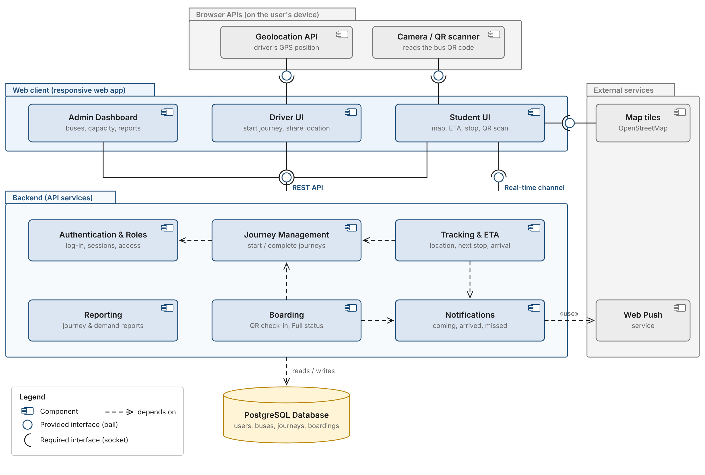

# ALU SmartBus 

Real-time bus tracking and QR boarding for the African Leadership University (ALU) Rebero ⇄ ALU shuttle.

Students see where the bus is, when it will reach their stop, and get an alert before it arrives. Drivers share their location from their phone and see who is waiting at each stop. ALU transport staff get reports on journeys, boardings and demand by stop.

> Course project for **Introduction to Software Engineering** at ALU. The full requirements and design are in [`docs/srs`](docs/srs).

**Live app:** https://alusmartbus.onrender.com (free hosting: after 15 idle minutes the first page can take up to a minute to load).

**Video demo:** https://youtu.be/oinoH1TnOuk

---

## The problem

Students waiting for the ALU shuttle have no way to know where the bus is or when it will arrive. They wait at stops for long periods or miss the bus, and the transport team has no data on how the buses are used.

## Features (MVP)

| Area | What it does | Requirements |
|---|---|---|
| Login and roles | Separate views for students, drivers and administrators | FR-01 to FR-05 |
| Buses | Register buses, set capacity, mark Available / Unavailable | FR-06 to FR-08, FR-36, FR-37, FR-49 to FR-52 |
| Journeys | Driver picks the bus and direction and starts the journey | FR-13 to FR-19 |
| Live tracking | Bus on a map, next stop and ETA, "location not live" warning | FR-20 to FR-27 |
| Stops and pickups | Choose a pickup stop, arrival detection, 3-minute boarding window | FR-09 to FR-12, FR-28 to FR-35 |
| QR boarding | Scan the bus QR code to board; Full status at capacity | FR-38 to FR-43, FR-53, FR-54 |
| Alerts | "Bus is coming", "bus has arrived" and "missed pickup" notifications | FR-44 to FR-48 |
| Reports | Journeys, boardings and demand by stop | FR-55 to FR-59 |

## Tech stack

| Layer | Technology |
|---|---|
| Backend | Python, **FastAPI**, Pydantic |
| Database | **PostgreSQL**, SQLAlchemy 2.0, Alembic (migrations) |
| Real time | FastAPI WebSockets |
| Front end | **React** + TypeScript + Vite, Leaflet (Stadia Maps tiles), qr-scanner |
| Notifications | In-app alerts while the app is open |
| Testing | pytest, pytest-cov |
| Code quality | Ruff (Python), ESLint + Prettier (JavaScript) |
| Hosting | Render (backend and website), Neon (PostgreSQL), nightly backups with GitHub Actions |

## Architecture

The system follows the component design in the SRS (Appendix B.4): a web client talks to the backend through a REST API and a real-time channel, and the backend stores everything in PostgreSQL.



More diagrams (use case, class, sequence, DFD levels 0 and 1) are in [`docs/diagrams`](docs/diagrams).

## Repository structure

```
aluSmartBus/
├── backend/          # FastAPI app (API, WebSockets, business logic, tests)
├── frontend/         # React web app (student, driver and admin views)
├── docs/
│   ├── srs/          # Software Requirements Specification
│   ├── diagrams/     # UML and DFD diagrams
│   └── sprint-plan.md
├── scripts/          # project set-up scripts
├── .github/          # issue and pull request templates
└── CONTRIBUTING.md   # branching, commits, Definition of Done
```

## Getting started

### Try it online

Open https://alusmartbus.onrender.com. Guests can see the live map and the buses without an account. Demo accounts are in the submission document.

### Run it on your own computer

**1. Install these first:** [Git](https://git-scm.com/downloads), [Python 3.11+](https://www.python.org/downloads/), [Node.js 20+](https://nodejs.org/) and [Docker Desktop](https://www.docker.com/products/docker-desktop/) (for the database). Start Docker Desktop.

**2. Get the code**

```bash
git clone https://github.com/ndavid-arch/aluSmartBus.git
cd aluSmartBus
```

**3. Start the database** (PostgreSQL in Docker, from the project folder)

```bash
docker compose up -d
```

**4. Set up the backend** (in a terminal, from the project folder)

```bash
cd backend
python -m venv .venv
source .venv/bin/activate              # Windows: .venv\Scripts\activate
pip install -r requirements-dev.txt
cp .env.example .env                   # Windows: copy .env.example .env
python -c "import secrets; print(secrets.token_urlsafe(32))"
```

Open `backend/.env` and replace `change-me` after `SECRET_KEY=` with the printed text. Then create the tables, add the route and its 13 stops, and create an admin account (it asks for a password):

```bash
alembic upgrade head
python -m app.seed
python -m app.create_user --name "Admin" --email admin@alueducation.com --role admin
```

**5. Start the backend** (leave this terminal open)

```bash
uvicorn app.main:app --reload
```

http://localhost:8000/health should show `{"status":"ok"}`.

**6. Start the website** (in a second terminal, from the project folder)

```bash
cd frontend
cp .env.example .env                   # Windows: copy .env.example .env
npm install
npm run dev
```

**7. Use it.** Open http://localhost:5173 and sign in as the admin. Add a bus on Admin → Buses and a driver on Admin → Drivers (it shows the driver's temporary password). Students sign up themselves with an `@alustudent.com` email.

**8. Run the tests** (optional, from `backend/` with the virtual environment active): `pytest`.

More detail: [backend/README.md](backend/README.md), [frontend/README.md](frontend/README.md). Hosting, environment variables, backups and maintenance: [docs/deployment.md](docs/deployment.md).

## How the work is managed

The project uses **Scrum** with two-week sprints after a set-up sprint:

| Sprint | Goal |
|---|---|
| Sprint 0 | Set-up, prototype in Figma, technical spike |
| Sprint 1 | Login, roles, buses and journeys |
| Sprint 2 | Live location, map, stops and ETA |
| Sprint 3 | Stop selection, arrival detection and alerts |
| Sprint 4 | QR boarding, Full status and admin reports |
| Sprint 5 | Match the prototype's design, route along the real roads, deployment |

Each user story is a GitHub Issue linked to its functional requirements, and progress is tracked on the project board. See [`docs/sprint-plan.md`](docs/sprint-plan.md) and [`CONTRIBUTING.md`](CONTRIBUTING.md).

## Author

**Ntwali Beni David**, African Leadership University
