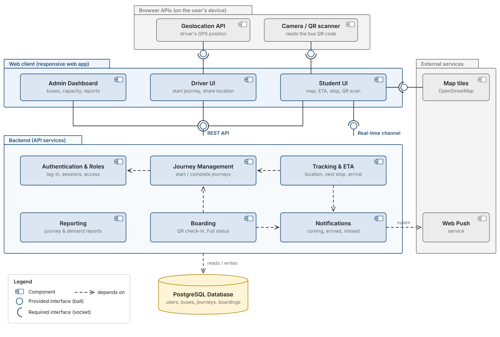

# ALU SmartBus 🚌

Real-time bus tracking and QR boarding for the African Leadership University (ALU) Rebero ⇄ ALU shuttle.

Students see where the bus is, when it will reach their stop, and get an alert before it arrives. Drivers share their location from their phone and see who is waiting at each stop. ALU transport staff get reports on journeys, boardings and demand by stop.

> Course project for **Introduction to Software Engineering** at ALU. The full requirements and design are in [`docs/srs`](docs/srs).

---

## The problem

Students waiting for the ALU shuttle have no way to know where the bus is or when it will arrive. They wait at stops for long periods or miss the bus, and the transport team has no data on how the buses are used.

## Features (MVP)

| Area | What it does | Requirements |
|---|---|---|
| Login and roles | Separate views for students, drivers and administrators | FR-01 to FR-05 |
| Buses | Register buses, set capacity, mark Available / Unavailable | FR-06 to FR-08, FR-36, FR-37, FR-49 to FR-52 |
| Journeys | Driver picks the bus and direction and starts the journey | FR-13 to FR-19 |
| Live tracking | Bus on a map, next stop and ETA, "location not live" warning | FR-20 to FR-27 |
| Stops and pickups | Choose a pickup stop, arrival detection, 3-minute boarding window | FR-09 to FR-12, FR-28 to FR-35 |
| QR boarding | Scan the bus QR code to board; Full status at capacity | FR-38 to FR-43, FR-53, FR-54 |
| Alerts | "Bus is coming", "bus has arrived" and "missed pickup" notifications | FR-44 to FR-48 |
| Reports | Journeys, boardings and demand by stop | FR-55 to FR-59 |

## Tech stack

| Layer | Technology |
|---|---|
| Backend | Python, **FastAPI**, Pydantic |
| Database | **PostgreSQL**, SQLAlchemy 2.0, Alembic (migrations) |
| Real time | FastAPI WebSockets |
| Front end | **React** + Vite, Leaflet (OpenStreetMap), html5-qrcode |
| Notifications | Web Push |
| Testing | pytest, pytest-cov |
| Code quality | Ruff (Python), ESLint + Prettier (JavaScript) |
| Hosting | Render (backend, database), static hosting for the front end |

## Architecture

The system follows the component design in the SRS (Appendix B.4): a web client talks to the backend through a REST API and a real-time channel, and the backend stores everything in PostgreSQL.



More diagrams (use case, class, sequence, DFD levels 0 and 1) are in [`docs/diagrams`](docs/diagrams).

## Repository structure

```
aluSmartBus/
├── backend/          # FastAPI app (API, WebSockets, business logic, tests)
├── frontend/         # React web app (student, driver and admin views)
├── docs/
│   ├── srs/          # Software Requirements Specification
│   ├── diagrams/     # UML and DFD diagrams
│   └── sprint-plan.md
├── scripts/          # project set-up scripts
├── .github/          # issue and pull request templates
└── CONTRIBUTING.md   # branching, commits, Definition of Done
```

## Getting started

> Set-up instructions will be added in Sprint 0 when the backend and front end are scaffolded.

## How the work is managed

The project uses **Scrum** with four two-week sprints after a set-up sprint:

| Sprint | Goal |
|---|---|
| Sprint 0 | Set-up, prototype in Figma, technical spike |
| Sprint 1 | Login, roles, buses and journeys |
| Sprint 2 | Live location, map, stops and ETA |
| Sprint 3 | Stop selection, arrival detection and alerts |
| Sprint 4 | QR boarding, Full status and admin reports |

Each user story is a GitHub Issue linked to its functional requirements, and progress is tracked on the project board. See [`docs/sprint-plan.md`](docs/sprint-plan.md) and [`CONTRIBUTING.md`](CONTRIBUTING.md).

## Author

**Ntwali Beni David**, African Leadership University
